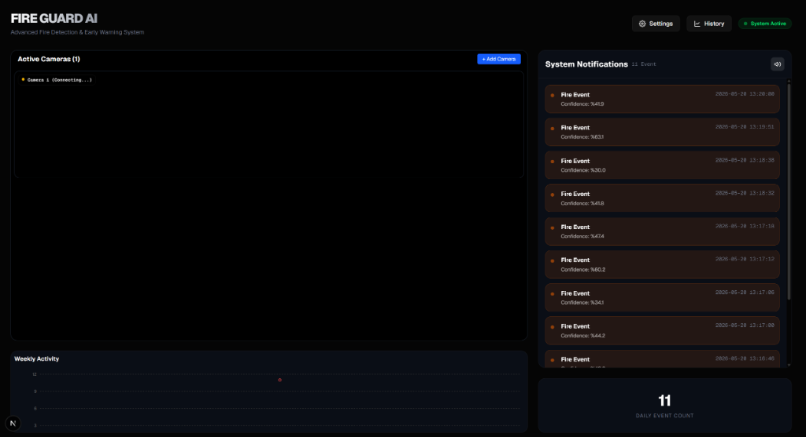

# Fire Guard AI

Fire Guard AI is a camera monitoring and fire detection system using real-time computer vision. The bundled model detects **Fire only**. Smoke detection requires a compatible, separately validated model containing a smoke class.

### Live Demo
Experience the live dashboard: [https://ai-fire-detection-drab.vercel.app/](https://ai-fire-detection-drab.vercel.app/)

[](https://ai-fire-detection-drab.vercel.app/)

## Features

### Real-Time Detection
* Real-time fire detection using the bundled YOLO model, with WebSocket updates on the dashboard.
* The settings screen shows the classes supported by the loaded model, including whether smoke detection is available.

### Persistent Multi-Camera Grid
* Monitor unlimited cameras simultaneously. All camera sources are persisted in a SQLite database, meaning they are saved even if the server restarts.
* Support for enabling/disabling cameras temporarily from the dashboard without deleting them.

### Automatic Reconnection
* Intelligent connection monitoring. If an RTSP or webcam source is disconnected, the system safely marks its status and attempts to reconnect asynchronously in the background every 10 seconds without blocking the pipeline.
* Interactive camera status indicators (Connected, Connecting, Disconnected, Inactive) with beautiful dark-mode placeholder states.

### Dynamic AI & Alarm Settings
* Configure AI Confidence Threshold, Alarm Cooldown, and Detection Persistence (number of frames) dynamically from the Settings Panel without restarting the application.
* Toggle siren sound alert directly in the UI, synchronized globally.
* Configure separate fire/smoke confidence overrides and the IoU threshold. Empty class overrides inherit the global confidence threshold.
* Confirmation counts consecutive processed frames, once per class in each frame. High confidence and multiple boxes in one frame do not bypass verification.
* Changing detection settings starts a fresh confirmation sequence while retaining alarm cooldowns.

### Camera Detection Regions & Performance
* Draw a polygon for each camera to restrict alarm eligibility. The center of a detection box must be inside the polygon; an empty polygon enables the full frame.
* Regions are saved in SQLite and use normalized coordinates, so they work across video resolutions.
* View measured processing FPS, inference time, and processed frame counts for each camera.

### Image Analysis
* Upload a JPEG, PNG, WebP or BMP image from the dashboard and review the annotated result and detection confidence.
* Image analysis supports confidence and IoU overrides and does not create camera events or send notifications.
* Uploads are limited to 10 MiB and 16 megapixels. This screen analyzes images; uploaded video analysis is not included.

### Statistics & History
* Interactive weekly statistics charts.
* Comprehensive history modal enabling users to view and search past fire/smoke detection events along with high-definition snapshots of the event moment.
* Filter events by camera, type, inclusive date range and minimum confidence, with pagination and a matching CSV download.
* Event records retain the camera name even when that camera is later deleted. Older records without camera metadata remain accessible.
* The daily count reflects all events recorded today, rather than the recent-alert list size.

### Instant Notifications
* Telegram: Receive real-time photos of the detected incident directly to your phone.
* Email: Detailed incident reports sent to your inbox.

## Tech Stack

* Backend: Python, FastAPI, OpenCV, Ultralytics (YOLOv8), SQLite, WebSockets
* Frontend: Next.js, React, Tailwind CSS, Recharts
* AI Model: Bundled custom YOLO model for Fire; configurable local model path
* Font assets and alarm audio are served or generated locally, without a Google network dependency.

## Installation

Follow these steps to run the project locally.

### Prerequisites
* Python 3.10+ (validated with Python 3.12)
* Node.js 20.9+ (validated with Node.js 24)
* Git

### Easy Setup (Windows Only)
You can start the backend and frontend simultaneously with a single command. Double-click or run:
```bash
start.bat
```
This script will automatically detect your Python installation, create a virtual environment, install requirements, and run both servers.

### Manual Setup

### 1. Clone the Repository
```bash
git clone https://github.com/vahapogut/AI-fire-detection.git
cd AI-fire-detection
```

### 2. Backend Setup
```bash
cd backend
# Create virtual environment
python -m venv venv
# Activate on Windows:
venv\Scripts\activate
# Activate on Mac/Linux:
# source venv/bin/activate

# Install the validated CPU-only PyTorch pair for cloud development
python -m pip install --index-url https://download.pytorch.org/whl/cpu "torch==2.5.1+cpu" "torchvision==0.20.1+cpu"

# Install application dependencies
pip install -r requirements.txt

# Start the server
python -m uvicorn main:app --reload --port 8000
```
*Backend runs at http://localhost:8000 by default.*

### 3. Frontend Setup
```bash
cd ../frontend
# Install packages
npm ci

# Start the application
npm run dev
```
*Frontend runs at http://localhost:3000 by default.*

## Usage

1. Open http://localhost:3000 in your browser.
2. Click Add Camera to add a camera source:
   - Webcam index: 0 or 1
   - IP Camera / Stream: rtsp://user:password@ip_address:554/stream
3. Go to Settings to configure Telegram, Email, and dynamic AI threshold options.
4. Alerts are emitted after the configured confidence, region, confirmation and cooldown policy passes. The bundled model detects fire; smoke requires a smoke-capable model.

Keep the backend working directory at `backend`: the database and snapshots are relative to that directory. Cloud machines usually have no webcam; configure a reachable stream or local video source instead.

To load your own trusted local model, set `FIRE_MODEL_PATH` before starting the backend. Check `/model` or the settings screen for actual supported classes. A different model must be evaluated on labeled fire, smoke and negative examples before relying on it.

For browser deployments outside the backend host, configure `NEXT_PUBLIC_API_URL` and `NEXT_PUBLIC_WS_URL` before building the frontend, and configure matching backend CORS origins.

## Development checks

```bash
cd backend
venv/bin/python -m unittest discover -s tests -v
cd ../frontend
npm run lint
npm run build
```

Research sources, implemented gaps and remaining development work are listed in [the feature comparison](docs/feature-research.md).

## License

Distributed under the MIT License. See LICENSE for more information.

---
## Contributors

- [vahapogut](https://github.com/vahapogut)
